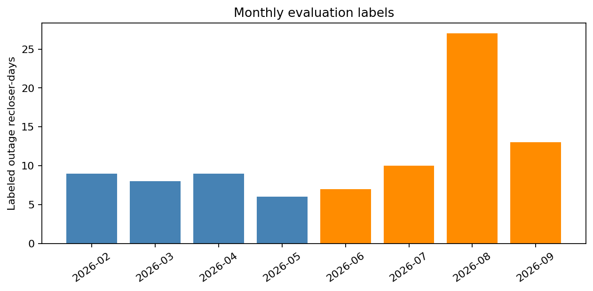
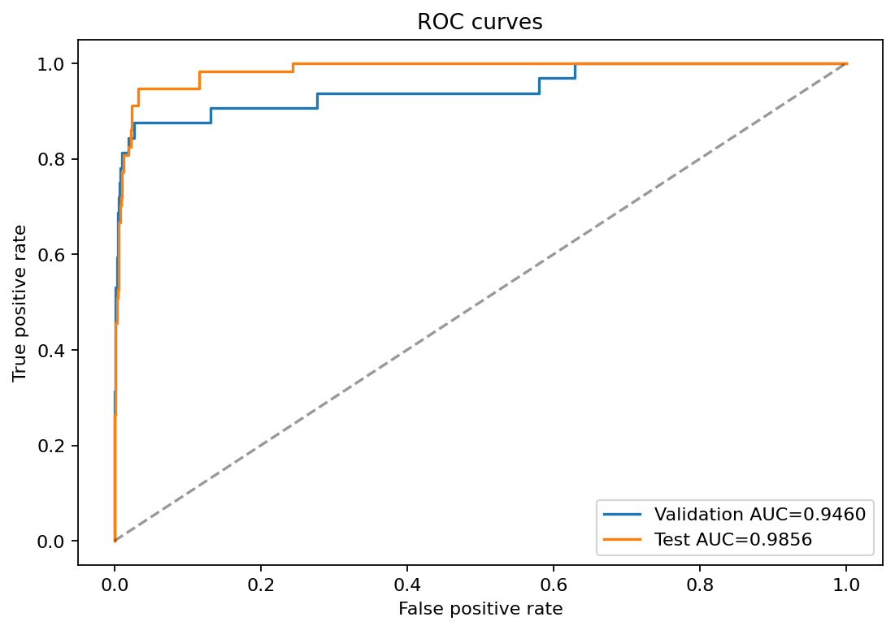
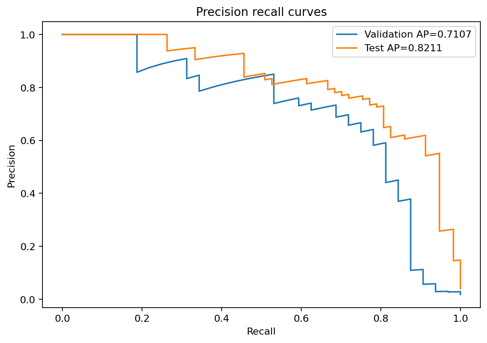
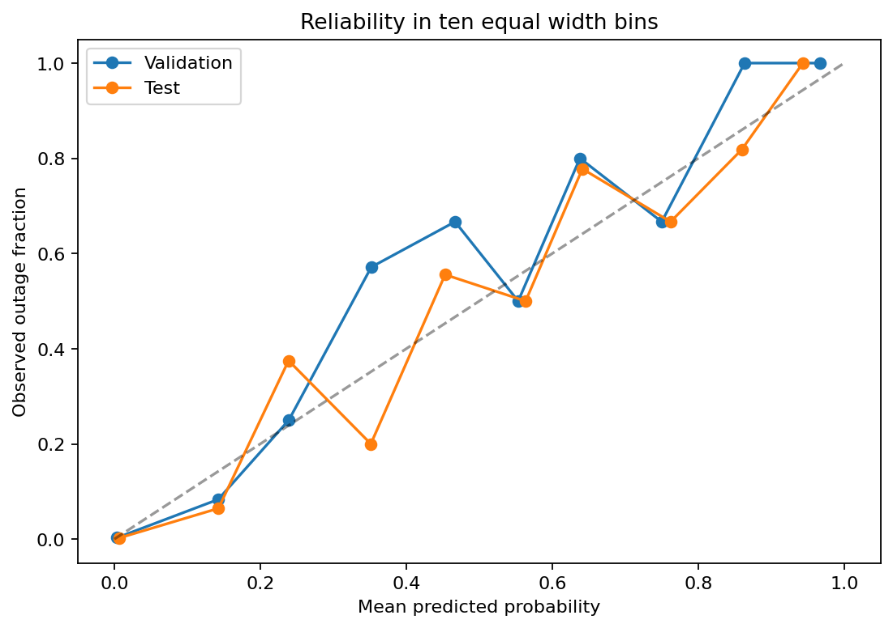
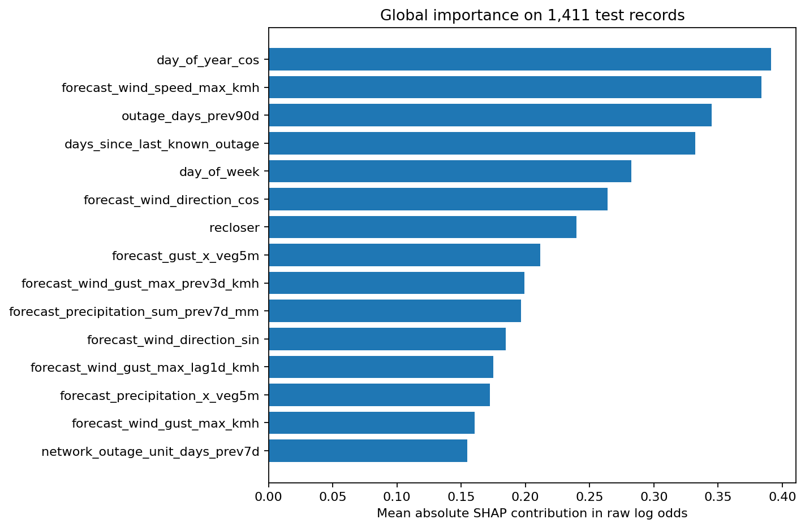
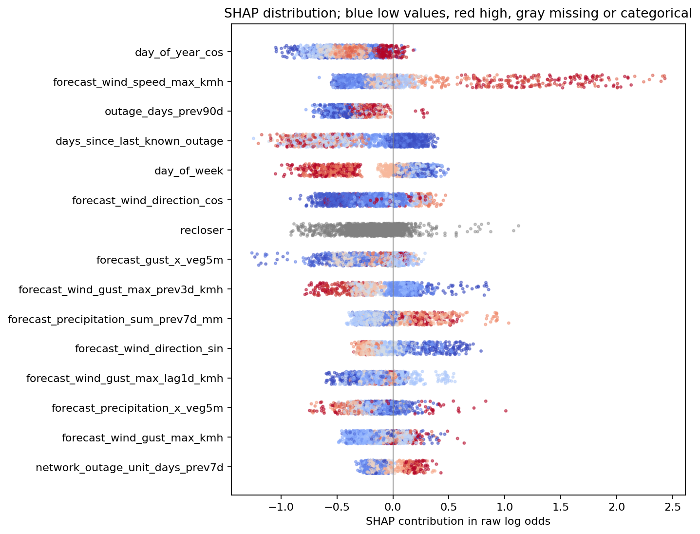
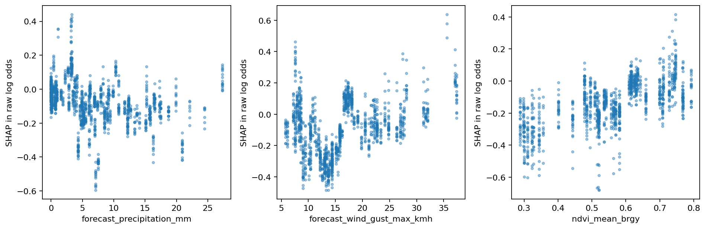

# CHAPTER V
# RESULTS AND DISCUSSION

This chapter presents the retrained XGBoost model for next-day outage probability forecasting in Puerto Princesa City. Following Sections 5.1 to 5.8 of the thesis PDF, it examines dataset characteristics, feature engineering, model development, predictive performance, probability calibration, SHAP interpretation, and engineered-feature contributions. The selected retrained model obtained test F1 of 0.754098 and ROC AUC of 0.985566. Results concern labeled recloser-days rather than outage hours or distinct city-wide incidents.

The chapter uses the separately saved retrained model and recomputed analyses. The retained evaluation partitions were reconstructed and checked against the archived model.

## 5.1 Dataset Summary

The supplied feature dataset contains 19,128 rows and 66 original predictors across 21 recloser names. Labels were recovered from the Git version only after all 65 shared feature columns were verified as exactly equal row for row. The recovered dataset contains 874 positive labels and 18,254 negative labels, giving prevalence of 4.57% and a negative-to-positive ratio of approximately 20.89:1. The number of barangays covered and records removed during initial cleaning cannot be established from these artifacts.

Table 5.1 Summary of the available dataset

| Characteristic | Measured value |
| --- | --- |
| Records | 19,128 |
| Positive / negative labels | 874 / 18,254 |
| Original / transformed inputs | 66 / 137 |
| Recloser identities | 21 |
| Class weight scale_pos_weight | 1 |
|  |

The PDF describes a 70%/15%/15% split, but the retained row counts imply 83.31%/9.32%/7.38%.

Table 5.2 Reconstructed partitions

| Set | Rows | Share % | Positives | Prevalence % |
| --- | --- | --- | --- | --- |
| Training | 15,935 | 83.31 | 785 | 4.9263 |
| Validation | 1,782 | 9.32 | 32 | 1.7957 |
| Test | 1,411 | 7.38 | 57 | 4.0397 |

## 5.1 Dataset Summary continued

Validation dates span 1 February to 31 May 2026; test dates span 2 June to 21 September 2026.

Figure 5.1 Monthly positive-label counts in evaluation records. Blue represents validation and orange test. Counts are labeled recloser-days, not distinct interruption events.

August has the largest positive-label count in the retained evaluation months. Unequal record coverage and the partial September sample prevent this pattern from establishing seasonality. A negative label indicates no matching recorded outage under the dataset labeling process; it does not independently verify uninterrupted service.

## 5.2 Feature Engineering Results

The retrained model uses 66 original inputs. This corrects the PDF narrative reporting 64. The difference is explained by repair-history inputs and recloser identity together with the actual saved group inventory; the model schema is the authoritative list. One-hot encoding and missing-value indicators expand the input representation to 137 columns.

Table 5.3 Feature groups used in retraining

| Feature group | Inputs |
| --- | --- |
| Target day forecast weather | 14 |
| Lagged forecast weather | 12 |
| Vegetation | 6 |
| Outage history | 8 |
| Infrastructure history | 10 |
| Repair history | 2 |
| Calendar | 6 |
| Identity | 1 |
| Wet weather history | 3 |
| Weather stress | 2 |
| Weather vegetation interactions | 2 |

Numeric inputs use training-fitted median imputation with missing indicators. Recloser identity and forecast weather code use training-fitted categorical encoding with unknown categories ignored. No feature selection or correlation-removal procedure was performed in this refit. The model therefore retains the supplied feature set rather than attributing absent variables to undocumented filtering.

Weather predictors are provided as forecast, lagged, and rolling quantities; historical outage and infrastructure inputs summarize past counts and recency. Vegetation indicators and weather-vegetation interactions are retained. Infrastructure variables are fault-history proxies, not measurements of asset age or physical condition. Weather-stress reference inputs were reused as supplied because the original fitting recipe is unavailable.
## 5.3 Model Development and Hyperparameter Tuning

The selected model was refitted on 15,935 reconstructed training rows with uniform weights and the archived XGBoost configuration. Preprocessing was refitted only on those training rows. The model used 400 fixed boosting rounds; this run did not perform a hyperparameter search or early stopping. The PDF placeholders describing search methods and stopping patience are therefore not asserted as completed procedures.

Table 5.4 XGBoost configuration

| Parameter | Value |
| --- | --- |
| objective | binary:logistic |
| tree_method | hist |
| max_depth | 10 |
| eta | 0.05 |
| min_child_weight | 1 |
| lambda | 1.0 |
| scale_pos_weight | 1 |
| max_delta_step | 1 |
| subsample | 0.9 |
| colsample_bytree | 0.9 |
| max_bin | 512 |
| seed | 42 |
| nthread | 1 |
| Boosting rounds | 400 |

Sigmoid calibration was fitted on validation raw logit scores with LogisticRegression, C = 1,000,000 and maximum 1,000 iterations. The fitted transformation is p_calibrated = sigmoid(1.1364218274 x logit(p_raw) + 0.6785921718). The warning threshold 0.3406459109 was selected to maximize validation F1 and then frozen for test scoring. Validation performance is therefore in-sample for calibration and threshold selection.

A warning is issued at calibrated probability of at least 34.064591%. If display risk bands are retained, Low is below 5%, Medium is from 5% to below the warning threshold, and High begins at the warning threshold. These are probability bins, not separately learned classes. The refitted booster JSON is identical to the archived booster, so changes in warning performance reflect calibration and threshold selection rather than newly improved tree rankings.

## 5.4 Predictive Performance of the Model Objective 2

Table 5.5 Validation and test performance

| Metric | Validation | Test | PDF benchmark |
| --- | --- | --- | --- |
| precision | 0.733333 | 0.707692 | Not specified |
| recall | 0.687500 | 0.807018 | Not specified |
| F1 | 0.709677 | 0.754098 | >= 0.60: met |
| ROC_AUC | 0.946018 | 0.985566 | >= 0.75: met |
| average_precision | 0.710665 | 0.821081 | Not specified |
| Brier_score | 0.008435 | 0.014950 | < 0.25: met |

The test model identified 46 of 57 positive recloser-days and issued 65 warnings. Recall was 80.70%, precision was 70.77%, and F1 was 0.754098. ROC AUC was 0.985566 and average precision was 0.821081. The F1 and AUC values meet the benchmarks stated in the PDF.

Figure 5.2 ROC curves from retrained calibrated outputs. AUC describes ranking across thresholds.

## 5.4 Predictive Performance continued

Table 5.6 Test confusion matrix at threshold 0.3406459109

| Actual label | No warning | Warning |
| --- | --- | --- |
| Non-outage | TN = 1,335 | FP = 19 |
| Outage | FN = 11 | TP = 46 |

Compared with the archived warning rule, false warnings fell from 30 to 19 while missed positive labels increased from 8 to 11. Test precision rose from 62.03% to 70.77% and F1 from 0.720588 to 0.754098, while recall fell from 85.96% to 80.70%. ROC AUC and average precision are unchanged. The new rule balances precision and recall by validation F1; it does not enforce a minimum recall target or encode operational outage costs.

Figure 5.7 Precision-recall curves. Average precision is included because positive labels are uncommon.

These point estimates do not include sampling intervals or statistical superiority tests.

## 5.5 Probability Calibration Objective 2

Table 5.7 Brier scores and training-prevalence reference

| Set | Raw | Calibrated | Baseline | Skill |
| --- | --- | --- | --- | --- |
| validation | 0.009160 | 0.008435 | 0.018615 | 0.546852 |
| test | 0.015807 | 0.014950 | 0.038844 | 0.615122 |

The baseline predicts the fixed training positive-label rate, 785/15,935 = 4.9263%, for every evaluation record. Its Brier score is computed on each evaluation set; it is not approximated by evaluation prevalence times one minus prevalence. Brier skill is 1 minus calibrated Brier divided by baseline Brier. On test, calibration reduced Brier from 0.015807 to 0.014950, with skill of 0.615122 against the training-rate baseline.

Figure 5.3 Reliability diagram using ten equal-width probability bins. Empty bins are omitted; bin counts are supplied in the accompanying CSV tables.

Mean test probability is 4.4869%, compared with observed prevalence of 4.0397%.

## 5.6 SHAP Based Feature Importance Objective 3

### 5.6.1 Global Feature Importance

Exact tree-path-dependent SHAP contributions were recomputed with XGBoost pred_contribs on all 1,411 test records of the selected retrained model. Contributions explain the raw tree log-odds margin, not percentage-point changes in calibrated probability. One-hot columns and missing indicators were summed into each original feature before calculating mean absolute attribution.

Figure 5.4 Fifteen highest original-input mean absolute SHAP values. Missing-indicator effects are included in each original input.

### 5.6.1 Global Feature Importance continued

Table 5.8 Ten highest-ranked original inputs

| Feature | Mean absolute SHAP | Mean signed SHAP |
| --- | --- | --- |
| day_of_year_cos | 0.391193 | -0.386781 |
| forecast_wind_speed_max_kmh | 0.383656 | 0.058689 |
| outage_days_prev90d | 0.345147 | -0.342517 |
| days_since_last_known_outage | 0.332284 | -0.188285 |
| day_of_week | 0.282568 | -0.043084 |
| forecast_wind_direction_cos | 0.263955 | -0.184078 |
| recloser | 0.239752 | -0.180289 |
| forecast_gust_x_veg5m | 0.211723 | -0.167005 |
| forecast_wind_gust_max_prev3d_kmh | 0.199300 | -0.058999 |
| forecast_precipitation_sum_prev7d_mm | 0.196364 | -0.046498 |

The largest mean absolute attribution belongs to day_of_year_cos, followed by forecast_wind_speed_max_kmh and outage_days_prev90d. These rankings describe model use of retained inputs on the test sample. Mean signed contributions indicate average movement relative to the reference margin; their signs do not establish whether increasing a feature always increases or decreases outage risk.

Figure 5.5 SHAP distribution with vertical jitter. Blue indicates lower numeric values, red higher values, and gray missing or categorical values. Colors use within-feature 5th to 95th percentile scaling.

### 5.6.2 Contribution by Feature Group

Table 5.9 Aggregated SHAP contribution by group

| Group | Sum of mean absolute SHAP | Share % |
| --- | --- | --- |
| Target day forecast weather | 1.927769 | 30.26 |
| Lagged forecast weather | 1.396360 | 21.92 |
| Outage history | 0.954199 | 14.98 |
| Calendar | 0.861606 | 13.53 |
| Vegetation | 0.498474 | 7.83 |
| Weather vegetation interactions | 0.383882 | 6.03 |
| Identity | 0.239752 | 3.76 |
| Infrastructure history | 0.046010 | 0.72 |
| Wet weather history | 0.034621 | 0.54 |
| Weather stress | 0.026970 | 0.42 |
| Repair history | 0.000133 | 0.00 |

Target-day forecast weather contributes the largest sum of feature-level mean absolute attributions. Lagged weather and outage history also have substantial attribution. Group percentages are shares of summed mean absolute SHAP values, not percentages of accuracy or causal influence. Correlated predictors can share attribution, and group sums differ from taking the absolute value of a net group contribution.

### 5.6.3 Feature Level Interpretation

Figure 5.6 Dependence plots for precipitation, wind gust, and mean barangay NDVI. Missing input values are omitted from these panels but remain represented in global attributions.

The dependence views show fitted-model associations across meteorological and vegetation inputs. They do not identify universal rainfall, gust, or NDVI failure thresholds. Calendar patterns may capture sampling, scheduling, or seasonal structure. Infrastructure histories describe reported fault occurrence rather than direct asset condition. Causal explanations require source-level evidence beyond these model attributions.

## 5.7 Contribution of Lagged and Cumulative Outage Features Objective 4

Five prespecified feature-addition variants were newly trained under the same reconstructed partitions, 400-round configuration, and uniform weighting. Each variant used training-fitted preprocessing, validation-fitted sigmoid calibration, and a maximum-F1 validation threshold frozen before test scoring. Variant F is the selected 66-input retrained model.

A contains target-day forecast weather, calendar, and identity. B adds lagged and wet-weather history; C adds outage history; D adds vegetation and its weather interactions; E adds infrastructure and repair history. F contains all inputs, including the supplied weather-stress variables. No variant was selected for deployment using the test scores.

Table 5.10 Newly reproduced test ablation results

| Set | Inputs | Precision | Recall | F1 | AUC | Brier | Threshold |
| --- | --- | --- | --- | --- | --- | --- | --- |
| A | 21 | 0.510417 | 0.859649 | 0.640523 | 0.975926 | 0.018312 | 0.218776 |
| B | 36 | 0.640000 | 0.842105 | 0.727273 | 0.973516 | 0.017806 | 0.345375 |
| C | 29 | 0.594937 | 0.824561 | 0.691176 | 0.978478 | 0.018971 | 0.212162 |
| D | 29 | 0.796610 | 0.824561 | 0.810345 | 0.986952 | 0.011931 | 0.383168 |
| E | 33 | 0.564706 | 0.842105 | 0.676056 | 0.975058 | 0.020465 | 0.331003 |
| F | 66 | 0.707692 | 0.807018 | 0.754098 | 0.985566 | 0.014950 | 0.340646 |

Lagged and wet-weather features changed test F1 by +0.086750 and ROC AUC by -0.002410 relative to A. These are conditional comparisons on one retained sample, not statistically established improvements or isolated causal effects.

Outage history changed test F1 by +0.050654 and ROC AUC by +0.002553 relative to A. These are conditional comparisons on one retained sample, not statistically established improvements or isolated causal effects.

Vegetation and interactions changed test F1 by +0.169822 and ROC AUC by +0.011026 relative to A. These are conditional comparisons on one retained sample, not statistically established improvements or isolated causal effects.

Infrastructure and repair history changed test F1 by +0.035533 and ROC AUC by -0.000868 relative to A. These are conditional comparisons on one retained sample, not statistically established improvements or isolated causal effects.

## 5.7 Contribution of Engineered Features continued

Table 5.11 Validation ablation results

| Set | Inputs | Precision | Recall | F1 | AUC | Brier | Threshold |
| --- | --- | --- | --- | --- | --- | --- | --- |
| A | 21 | 0.621622 | 0.718750 | 0.666667 | 0.943429 | 0.009156 | 0.218776 |
| B | 36 | 0.750000 | 0.656250 | 0.700000 | 0.953286 | 0.008873 | 0.345375 |
| C | 29 | 0.560976 | 0.718750 | 0.630137 | 0.922804 | 0.010850 | 0.212162 |
| D | 29 | 0.827586 | 0.750000 | 0.786885 | 0.954250 | 0.006812 | 0.383168 |
| E | 33 | 0.785714 | 0.687500 | 0.733333 | 0.935607 | 0.008754 | 0.331003 |
| F | 66 | 0.733333 | 0.687500 | 0.709677 | 0.946018 | 0.008435 | 0.340646 |

Validation results were used for calibration and threshold selection and are therefore optimistic for those steps. Adding a group does not necessarily improve every metric, and the all-input model need not dominate every smaller variant. SHAP importance and feature-addition experiments answer different questions: attribution describes the selected fitted model, while retraining comparisons measure the behavior of alternative fitted models under the stated protocol.

## 5.8 Discussion

### Relation to the reviewed literature

The thesis PDF positions the study within research combining weather, outage histories, vegetation, and infrastructure proxies. The present results support evaluating these information sources jointly. No numerical superiority over external studies is claimed: geography, forecast horizon, labeling, class balance, and evaluation design differ. The literature discussion here follows the thesis framing rather than introducing unverified external study metrics.

### Weather history vegetation and infrastructure

Weather has substantial global attribution, while outage history, calendar structure, vegetation, and interactions also influence the selected model. The new ablations quantify changes from adding groups to a common baseline, but do not establish that every group improves generalization. Vegetation resolution, missing values, and history-based infrastructure proxies constrain physical interpretation. The same tree model was reproduced by retraining, reinforcing that the new warning tradeoff comes from calibration and threshold selection.

## 5.8 Discussion continued

### Routine and weather driven outages

The available labels do not include independently validated outage causes or severe-weather regimes. Monthly counts and daily weather inputs cannot support separate claims about routine, typhoon-related, planned, or unplanned interruption performance. Such comparisons require cause labels, regime definitions, and adequate positive counts.

### Practical implications for PALECO

The model can rank recloser-days for further review. At the selected threshold, 46 positive labels were detected, 19 warnings matched negative labels, and 11 positive labels were missed. The lower false-warning burden comes with lower recall than the archived rule. A prospective pilot should determine whether that tradeoff suits response capacity and missed-outage costs before operational adoption. Crew deployment benefits, outage prevention, and continuous-service verification were not measured.

Objective 1 is supported by the fitted integration of the retained predictors, subject to provenance limits. Objective 2 has reproduced classification, ranking, and probability-error evidence. Objective 3 has newly computed SHAP arrays, additivity verification, tables, and figures. Objective 4 has newly reproduced feature-addition comparisons under the documented protocol. These results establish model behavior on the retained sample rather than causal outage drivers or deployment readiness.

### Reproducibility record

The selected model is reports/retraining/retrained_model.joblib. Model results and row partitions are retained under reports/retraining. This report uses newly generated SHAP arrays, calibration tables, monthly counts, ablation models, and analysis verification under reports/chapter5_retrained. Scripts build_chapter5_analysis.py and write_chapter5_report.py reproduce the analyses and report. The source thesis Chapter V is on PDF pages 48 to 58, printed pages 44 to 54; its placeholders and prior scores have been replaced or qualified here.
